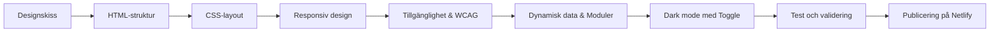

# u01-ludvig

[](#)
[](#)
[](#)
[](https://netlify.app)

**Live-sida:** [https://netlify.app](https://netlify.app)

https://github.io


En responsiv och dynamisk portfolio-webbplats byggd med HTML, CSS och modern JavaScript (ES2024). Projektet är en översättning av en designskiss till kod, med stort fokus på modulär kodstruktur, mörkt läge, tillgänglighet (WCAG) och robust felhantering.



## Innehåll

- [Om projektet](#om-projektet)
- [Funktioner](#funktioner)
- [Tekniker](#tekniker)
- [Projektstruktur](#projektstruktur)
- [Responsiv design](#responsiv-design)
- [Dark mode](#dark-mode)
- [Tillgänglighet](#tillgänglighet)
- [Reflektion](#reflektion)

---

## Om projektet

Portfolio-sidan består av flera sektioner: en introduktion med profilbild, en CV-sida med dynamiskt genererade arbetsbeskrivningar och utbildningar, en teknologisektion med optimerade SVG-ikoner samt en projektsida som automatiskt renderar projektkort med hjälp av data från GitHub.

Projektet har under utvecklingens gång utvecklats från en statisk sida till en modern, asynkron webbapplikation. Fokus har legat på att hålla koden DRY (*Don't Repeat Yourself*) genom att bryta ut logik i återanvändbara ES2024-moduler och använda strukturerad JSON-data för att bygga gränssnittet dynamiskt.

Målet var inte bara att få sidan att exakt likna designen, utan också att skriva semantisk, feltolerant och fullt tillgänglig kod för alla typer av enheter.

---

## Funktioner

- **Responsiv layout:** Sömlös anpassning för mobil, surfplatta och desktop via CSS Grid och Flexbox.
- **Dynamiska projektkort:** Hämtar data från GitHub API och genererar projektkort dynamiskt i realtid med `map()` och *object destructuring* (`name`, `html_url`, `description`).
- **Återanvändbar CV-generator:** Funktioner som `fetchWorkAndEducation()` läser in JSON-data och bygger upp CV-sektionen programmatiskt istället för med hårdkodad HTML.
- **Interaktiv hamburgermeny:** En JavaScript-driven meny som lyssnar på klickhändelser och hanterar synlighet på mindre skärmar.
- **Mörkt läge (Dark Mode) med Toggle:** Stödjer både systeminställningar och en manuell knapp i headern för att växla tema.
- **Robust felhantering:** Om ett nätverksfel uppstår eller JSON-filen inte kan hämtas, visas en fallback-iframe med ett användarvänligt felmeddelande.
- **Prestandaoptimerad grafik:** Återanvänder tunga SVG-ikoner via grupp-id:n och `<use>`-element istället för repetitiv kodning.
- **Automatiserad CI/CD:** Distribuerad live på Netlify med automatisk publicering via GitHub Actions (`static.yml`).

---

## Tekniker

| Teknik | Användning |
|---|---|
| **HTML5** | Semantisk struktur (`<main>`, `<section>`, `<article>`), tillgängliga knappar och optimerade SVG:er. |
| **CSS3** | Avancerad layout, CSS-variabler, gradienter (`background-clip: text`) och flytande responsivitet. |
| **Flexbox** | Dynamisk positionering av navigation, introduktion, kortinnehåll och footern. |
| **CSS Grid** | Rutnätssystem för teknologiikoner och projektkort i desktop-vy. |
| **JavaScript (ES2024)** | Modulär struktur (`type="module"`), asynkrona API-anrop (`fetch`), array-metoder (`map`) och händelsehantering. |
| **GitHub API & JSON** | Datakällor för att hålla projekt och CV-innehåll helt dynamiskt. |
| **Netlify & GitHub Actions** | Automatiserad byggprocess och live-distribution. |

---

## Projektstruktur

```text
.
├── index.html
├── base.css
├── 2ndpage.css
├── 3rdpage.css
├── 4thpage.css
├── footer.css
├── base.js
├── replaceChild.js
└── README.md
```

- `index.html` innehåller sidans grundstruktur, globala SVG-definitioner och modullänkningar.
- `base.css` hanterar globala variabler, grundstilar, mörkt läge och den gemensamma headern/navigationen.
- `2ndpage.css`, `3rdpage.css` och `4thpage.css` separerar stilarna för de olika sektionerna.
- `footer.css` innehåller specifika stilar och gradienter för footern.
- `base.js` agerar huvudmodul (`type="module"`) som hanterar asynkron laddning, hamburgermenyn och initierar CV- och projektgenereringen.
- `replaceChild.js` är en utbruten, renodlad hjälpmodul för att effektivt uppdatera och rensa DOM-element.

---

## Responsiv design

Jag använde en kombination av Flexbox och Grid. Grid användes främst för större layouter, till exempel teknologiikoner och projektrutor, där innehållet behövde ligga i tydliga rader och kolumner. Flexbox användes för element som behövde anpassa sig mer dynamiskt, till exempel navigation, introduktion, kort och beskrivningar.

Under projektets gång strukturerades mobil- och desktop-layouterna om. Grid implementerades på sida 2 istället för enbart Flexbox, och sektioner gjordes helskärmstäckande (`vh`) för en mer polerad och modern stil. Brytpunkterna valdes utifrån när layouten började se trång eller trasig ut, och element döljs eller expanderas baserat på tillgänglig bredd.

```css
@media (min-width: 860px) {
  header {
    flex-direction: row;
    flex-wrap: nowrap;
  }

  .hamburgare div {
    display: none;
  }

  .hamburgare-meny {
    flex-direction: row;
    margin-left: auto;
  }
}
```

---

## Dark mode

Dark mode aktiveras både automatiskt baserat på användarens systeminställning (`prefers-color-scheme`) och manuellt via en dedikerad knapp i headern. Färghanteringen styrs centralt via CSS-variabler i `:root`.

```css
:root {
  --background: #ffffff;
  --text: #1f1f1f;
  --muted-text: #5c5c5c;
}

@media (prefers-color-scheme: dark) {
  :root {
    --background: #121212;
    --text: #f1f1f1;
    --muted-text: #d6d6d6;
  }
}
```

För att hantera grafik i mörkt läge gjordes specifika anpassningar:
1. **SVG-invertering:** Enkla, svarta ikoner (som kalkylator-ikonerna på sida 2) inverteras med `filter: invert(1)` när mörkt läge är aktivt.
2. **Dynamiska variabler:** Rubriker (`h2`) och projektkort skiftar färg sömlöst genom att lyssna på det aktiva temat.

---

## Tillgänglighet


Jag använde Lighthouse, WCAG Contrast Checker och W3C-validatorn för att löpande testa och tillgänglighetssäkra sidan.

### Interaktivitet och Semantik
Lighthouse påpekade inledningsvis att sidan saknade en tydlig rubrikstruktur och att interaktiva element behövde korrekta roller. För att åtgärda detta gjordes flera viktiga förändringar:
- **Semantiska element:** Generiska `div`-behållare på sida 2 och 4 strukturerades om till semantiska `<article>`- och listelement. En `<h1>`-rubrik lades till på första sidan för att förankra dokumentets hierarki korrekt.
- **Från länkar till knappar:** Hamburgermenyn ändrades från att vara ett felaktigt länk-element (`<a>`) till en semantiskt korrekt `<button>` utrustad med `aria-label`.
- **Tangentbordsnavigering:** Implementerade `:focus-visible` för att säkerställa att en tydlig fokusindikator visas när en användare navigerar på webbplatsen med enbart tangentbord.

### Kontraster och Validering
Färgkontraster kontrollerades noggrant. Flera nyanser av blått, grönt samt färger i footern justerades för att garantera att de möter WCAG-kravet på minst 4.5:1 mot bakgrunden.

Den absolut största utmaningen var W3C-validatorn, där projektet inledningsvis flaggade för runt 130 fel. Genom att systematiskt rensa koden lyckades jag åtgärda samtliga fel genom att:
- Byta ut otillåtna `<text>`-element under `div`-taggar mot korrekta `<span>`-element.
- Korrigera nestningsfel (se till att blockelement inte ligger inuti paragrafer (`<p>`)).
- Ersätta felaktiga `alt`-attribut på inline-SVG:er med `role="img"` och `aria-label`.

---

## Reflektion

### Från skiss till kod
Det var en lärorik utmaning att översätta designskissen till ren kod. Det svåraste var till en början att bevara designens visuella identitet samtidigt som färgerna justerades för att klara de strikta tillgänglighetskraven (WCAG). Textstorlekar, marginaler och profilbildens dimensioner finjusterades i several omgångar (särskilt för mobilvy) för att undvika att gränssnittet kändes trångt eller trasigt.

Att implementera linjära gradienter i kombination med `background-clip: text` krävde en del efterforskning, men gav logotypen och footern det önskade moderna utseendet.

### Semantik och JavaScript-arkitektur
Att gå från att skriva rent statisk HTML till att bygga modulär kod har förändrat hur jag ser på projektstruktur. Genom att introduceras för ES2024-moduler (`type="module"`) lärde jag mig vikten av separation av logik. Att flytta ut DOM-manipulation till en egen fil (`replaceChild.js`) och låta JavaScript läsa in CV-innehåll från JSON-filer har gjort hela kodbasen mycket mer skalbar och lättunderhållen. 

Arbetet har visat hur viktigt det är att skriva välstrukturerad, semantisk HTML från allra första början, snarare än att försöka lappa ihop tillgänglighet och valideringsfel i slutet av projektet.
